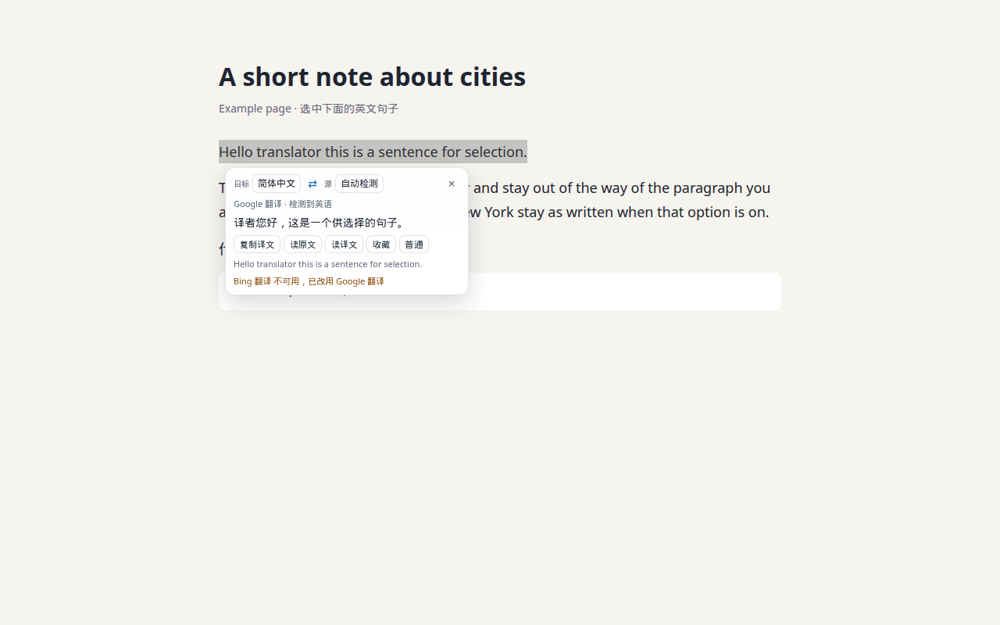
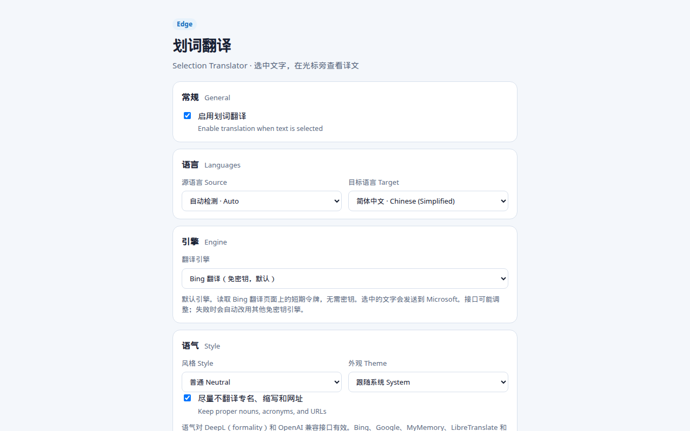
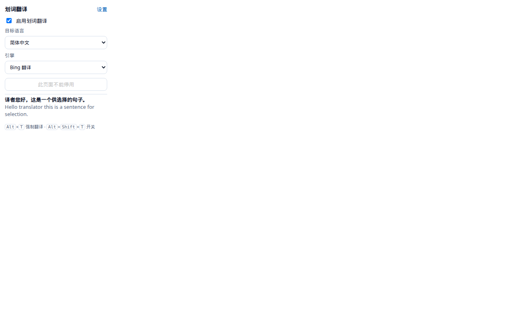

# 划词翻译

选中网页文字，在光标旁显示翻译。适用于 Microsoft Edge（Chromium）与其他 Chromium 浏览器。Manifest V3，无需构建步骤。

[English](#english) · [隐私政策](privacy-policy.md) · [商店文案](STORE_LISTING.md)

## 安装（加载解压缩的扩展）

1. 克隆本仓库，或下载 ZIP 后解压。安装时选择**仓库根目录**（里面有 `manifest.json`），不要选 `src`。
2. 打开 Edge，地址栏输入 `edge://extensions`。
3. 打开左侧或页面上的「开发人员模式」。
4. 选择「加载解压缩的扩展」，指向本仓库根目录。
5. 固定工具栏上的「划词翻译」图标。在任意 http 或 https 页面用鼠标选中文字，面板会出现在光标旁。

Chrome 的步骤相同，地址是 `chrome://extensions`。

开发检查：

```bash
npm test
npm run smoke:inject
npm run smoke:e2e
npm run pack
```

`npm test` 不需要安装依赖。`pack` 会在 `dist/edge-selection-translator.zip` 生成只含 `manifest.json`、`icons/` 和 `src/` 的商店包。

## 功能

- 鼠标选中文字后，在光标旁显示译文。面板顶部选择目标语言。点击面板外部、按 Esc 或滚动页面即可关闭。
- 自动检测源语言，一键对调语言。源语言和目标语言相同时，会在中文和英文之间改译。
- 复制译文。用 Web Speech API 朗读原文或译文。
- 快捷键：`Alt+T` 强制翻译当前选区，`Alt+Shift+T` 开启或关闭划词翻译。可在 `edge://extensions/shortcuts` 里修改。
- 工具栏弹出页和选项页可改开关、语言、引擎、语气、主题和密钥。
- 最近翻译（约 50 条）和收藏（约 100 条）保存在本机。
- 按网站停用。`pre`、`code`、`kbd`、`samp` 以及 Monaco、CodeMirror、Ace、highlight.js、Shiki 等代码表面里的选区不翻译。密码框不读取。
- 引擎：
  - **Bing 翻译**（默认，免密钥）。读取 `www.bing.com/translator` 页面里的短期令牌，再请求 `ttranslatev3`。这是公开页面接口，不是稳定的官方 SLA。`https://edge.microsoft.com/translate/auth` 目前返回 404，所以没有使用。无头浏览器的 User-Agent 可能被拒绝，真实的 Edge 窗口可以正常取得令牌。
  - **Google 翻译**（免密钥回退）。非官方 `translate.googleapis.com` `client=gtx` 接口，可能限流或下线。
  - **MyMemory**（免密钥回退）。匿名配额较小，长文本按大约 450 字分段。
  - **DeepL**、**OpenAI 兼容接口**、**LibreTranslate**、**Azure 翻译**。密钥写在选项页，只存在 `chrome.storage.local`。保存时会请求可选主机权限。未填密钥或请求失败时，回退到免密钥引擎，并在面板说明。LibreTranslate 公共实例通常要求密钥。
- 语气：普通、更口语、更正式。DeepL 使用 `formality`，OpenAI 兼容接口写进系统提示。其他引擎仍按普通风格翻译，并提示不支持语气。
- 可选：尽量不翻译网址、邮箱、全大写缩写和连续的英文专名。这是本地启发式规则，不是语法分析。
- 外观跟随系统深色模式，也可在选项里固定浅色或深色。面板半透明。

## 权限说明

| 权限 | 原因 |
| --- | --- |
| `storage` | 在本机保存设置、历史、收藏、黑名单和 API 密钥。不使用同步存储。 |
| `contextMenus` | 右键「翻译选中文字」，以及按当前网站停用或恢复。 |
| `https://www.bing.com/*` | 默认引擎。选中的文字会发送到 Microsoft 的 Bing 翻译页面接口。 |
| `https://translate.googleapis.com/*` | 免密钥回退。选中的文字会发送到 Google。 |
| `https://api.mymemory.translated.net/*` | 免密钥回退。选中的文字会发送到 Translated（MyMemory）。 |
| 可选 `https://*/*`，以及 `http://localhost/*`、`http://127.0.0.1/*` | 仅当你在选项页保存 DeepL、OpenAI 兼容接口、LibreTranslate 或 Azure 时，由你确认后授予，用来访问该引擎。 |
| 内容脚本匹配 `http://*/*`、`https://*/*` | 读取你选中的文字并挂上隔离样式的面板。不使用 `activeTab` 或 `scripting`。 |

没有作者一方的服务器，没有远程代码，没有遥测。详见 [privacy-policy.md](privacy-policy.md)。

## 发布到 Microsoft Edge 加载项

清单依据：[Publish a Microsoft Edge extension](https://learn.microsoft.com/microsoft-edge/extensions/publish/publish-extension)。需要你自己的合作伙伴中心账号。

1. 在 [Partner Center](https://partner.microsoft.com/dashboard/microsoftedge/overview) 注册开发人员账号并加入 Microsoft Edge 计划，接受开发者协议。
2. 在本仓库运行 `npm test` 和 `npm run pack`。上传 `dist/edge-selection-translator.zip`。包内根目录必须有 `manifest.json`。不要把 `tests/`、`.git/` 打进去。
3. 新建扩展，上传该 ZIP。若校验失败，按页面提示改清单后重新打包上传。
4. 填写可用性：公开，以及你要上架的市场。本扩展不含成人内容。
5. 属性：分类选 **Productivity**。网站可填本仓库地址。支持联系可用 GitHub Issues。
6. 隐私：单一用途写「在用户选中网页文字时，于光标旁显示译文」。按上一节逐项填写权限理由。远程代码选 **否**。数据使用按 [STORE_LISTING.md](STORE_LISTING.md) 的披露勾选：处理选中的文本，发送到用户所选翻译服务，不出售，默认无遥测。隐私政策 URL 使用 GitHub Pages：仓库 Settings → Pages → 分支 `main`、目录 `/docs`，然后填写 `https://codemanhr.github.io/edge-selection-translator/privacy-policy.html`。Pages 生效前不要提交审核。
7. 商店详情：名称为「划词翻译」。长描述从 [STORE_LISTING.md](STORE_LISTING.md) 复制，zh-CN 与 en 各一份，每份至少 250 个字符。简短描述来自清单 `description`，要改就改清单并重新上传包。徽标至少 128×128，建议 300×300，可用 `icons/icon128.png` 放大或另做。截图可选，最多 6 张，尺寸只能是 640×480 或 1280×800。
8. 在提交页写下测试步骤：打开一篇 https 文章，选中一句英文，确认面板出现译文；在代码块里选中，确认不出现面板。DeepL 等引擎需要审核员自己的密钥。然后发布。认证可能需要若干个工作日。

## 截图

下面三张是无头 Chrome 在本地示例页上的自动截图，尺寸 1280×800，用来看布局。Bing 在无头浏览器里常被拒绝，面板会改用 Google。上架前请在真实的 Edge 窗口里重拍，替换 `docs/screenshots/`。







若图片还没生成，在仓库根目录运行 `node scripts/capture-ui.js`（需要能加载扩展的 Chrome for Testing）。建议补拍的画面：

1. 一篇普通文章上，选区旁边的翻译面板，能看到目标语言和译文。
2. 选项页，能看到引擎、语气和「密钥只存在本机」。
3. 点击工具栏图标后的弹出页，能看到开关和快捷键。

## 许可

[MIT](LICENSE) © 2026 codemanhr

## English

Select text and a compact translation panel appears beside the cursor. The package is a Manifest V3 extension for Microsoft Edge and other Chromium browsers. Load the repository root. There is no build step.

### Install (Load unpacked)

1. Clone this repository, or unzip a source archive. Choose the folder that contains `manifest.json`.
2. Open `edge://extensions`.
3. Turn on Developer mode.
4. Choose Load unpacked and select this folder.
5. Pin 划词翻译. Select text on an http or https page.

`npm test` runs the unit checks with Node only. `npm run pack` writes `dist/edge-selection-translator.zip` containing `manifest.json`, `icons/`, and `src/`.

### Features

- A shadow-DOM panel opens next to the selection, with the target language at the top. Outside click, Esc, and page scroll dismiss it.
- Local source-language detection and a one-click language swap. A same-language pair flips between Chinese and English.
- Copy, and speak the original or the translation with the Web Speech API.
- `Alt+T` force-translates. `Alt+Shift+T` toggles the feature. Change the keys at `edge://extensions/shortcuts`.
- Popup and options page for the switch, languages, engine, tone, theme, and keys.
- Local history (about 50) and favorites (about 100).
- Per-site blacklist. Selections in `pre`, `code`, `kbd`, `samp`, and common editor surfaces are skipped. Password fields are ignored.
- Engines: keyless Bing (default; public page token, not an SLA; `edge.microsoft.com/translate/auth` currently returns 404), keyless unofficial Google, keyless MyMemory, plus optional DeepL, OpenAI-compatible, LibreTranslate, and Azure keys stored only in `chrome.storage.local`. A missing key or a failed request falls back to a free engine. Tone (neutral, colloquial, formal) is applied by DeepL and OpenAI-compatible endpoints. Other engines say the tone was not applied. Proper-noun shielding is a local heuristic for URLs, emails, acronyms, and multi-word title-case names.
- The panel follows `prefers-color-scheme` unless you pin light or dark.

### Permissions

`storage` keeps settings, history, favorites, the blacklist, and API keys on the device. `contextMenus` adds translate and per-site pause. The three required host permissions send the selection to Bing, Google, or MyMemory. Optional host permissions are requested from the options page only when you save a keyed engine, including localhost for a self-hosted LibreTranslate. Content scripts match `http://*/*` and `https://*/*` so the panel can attach to the page. The extension does not request `activeTab` or `scripting`. There is no author server, no remote code, and no telemetry. See [privacy-policy.md](privacy-policy.md).

### Publish to Microsoft Edge Add-ons

You need a Partner Center account. Checklist, following [the Edge publish guide](https://learn.microsoft.com/microsoft-edge/extensions/publish/publish-extension):

1. Enroll at Partner Center and accept the developer agreement.
2. Run `npm test` and `npm run pack`. Upload `dist/edge-selection-translator.zip`.
3. Create the extension and fix any package validation errors.
4. Set availability and markets. There is no mature content.
5. Category: Productivity. Website: this repository. Support: the GitHub Issues URL.
6. Privacy: single purpose is translating the text the user selects. Justify `storage`, `contextMenus`, and the host permissions as in the table above. Remote code: No. Disclose that selected text is sent to the chosen engine, keys and history stay local, data is not sold, and telemetry is none. Publish GitHub Pages from the `main` branch `/docs` folder and use `https://codemanhr.github.io/edge-selection-translator/privacy-policy.html`.
7. Store listing name is 划词翻译, matching the manifest. Paste the zh-CN and English descriptions from [STORE_LISTING.md](STORE_LISTING.md) (250–10,000 characters). The short description is the manifest `description`; change the manifest and re-upload to edit it. Logo at least 128×128, preferably 300×300. Screenshots, if you add them, must be 640×480 or 1280×800, up to six.
8. Certification notes: select an English sentence on an https page and expect a translation; select inside a code block and expect no panel. Keyed engines need the reviewer’s own key. Submit. Certification can take several business days.

### Screenshots

The images under `docs/screenshots/` are 1280×800 captures from headless Chrome on a local fixture. Bing often rejects that user agent, so the panel may show the Google fallback. Retake them in a normal Edge window before you submit to the store.


Shots to replace: the panel beside a real article, the options page showing the engine and the on-device key note, and the toolbar popup with the enable switch.

### License

[MIT](LICENSE) © 2026 codemanhr
